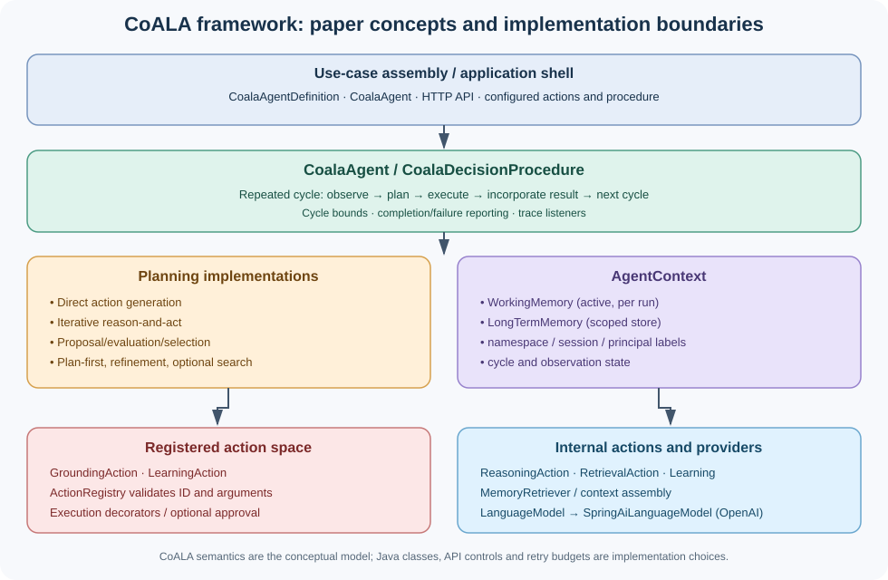
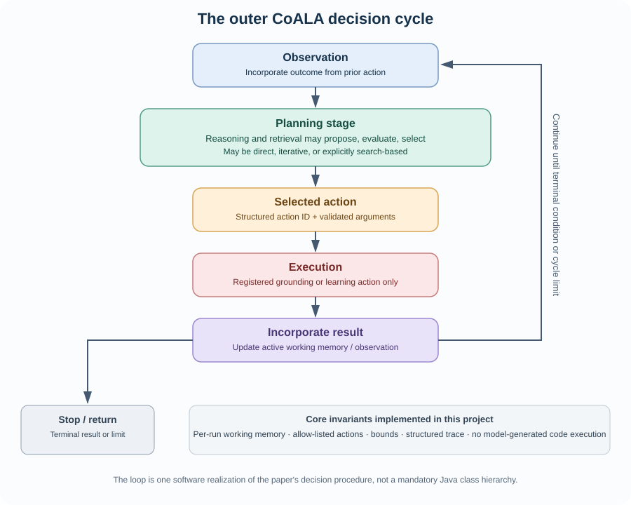
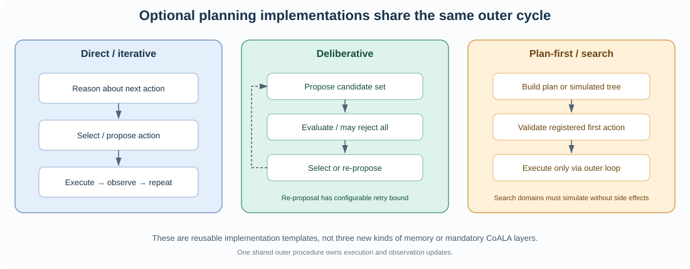
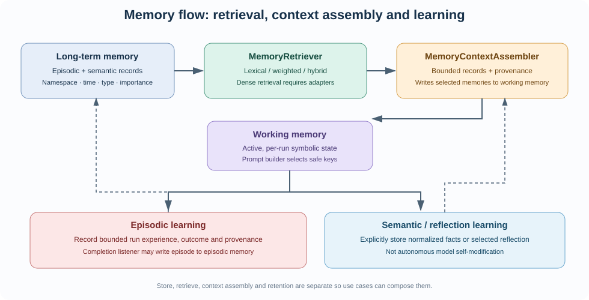

# CoALA Java Framework — Detailed Architecture and Built-in Component Catalogue

**Version:** project snapshot 0.1.0-SNAPSHOT  
**Language/runtime:** Java 21  
**Application shell:** Spring Boot 4.1.1  
**LLM adapter:** Spring AI 2.0.1, OpenAI starter  
**Conceptual reference:** Sumers, Yao, Narasimhan and Griffiths, *Cognitive Architectures for Language Agents* (TMLR, 2024), especially Sections 4.1–4.6 and Figures 3–5.  
**Implementation rule:** the paper is the authority for claims about CoALA. The Java contracts, REST API, memory adapters, safety limits, retry budgets and sample procedures are engineering choices made in this repository.

## Executive summary

This project provides a reusable Java framework organized around CoALA's three conceptual dimensions: **memory**, **action space**, and a **decision-making procedure**. The use cases are assembled from the framework; their business logic should live in use-case-specific actions and configuration rather than in the generic procedure classes.

The code includes a repeated outer decision cycle, working memory, episodic and semantic long-term memory, reasoning/retrieval/learning action contracts, allow-listed grounding/learning actions, several optional planning templates, pluggable memory retrieval policies, search algorithms, action-safety decorators, learning operations, tracing hooks, provider integration and an HTTP application shell.

The central design decision is to avoid making a `ReasoningStrategy`, `ReasoningMode`, or `SearchAlgorithm` mandatory for every agent. Those can be useful implementation extension points, but they are not components prescribed as separate software interfaces by the paper. A simple agent does not need a tree search; a search-based agent can opt into the search module without changing the outer decision-cycle contract.

> **Verification status:** the project includes CI configuration and expanded tests. This authoring environment has Java 21 but could not download Maven 3.10.0 because Apache distribution hosts failed DNS resolution. The final ZIP therefore must not be described as having passed the complete dependency-backed Maven build here. Details are in [Verification and release gates](#15-verification-and-release-gates).

## 1. Conceptual fidelity: what the paper says and how the code maps to it

### 1.1 Three architectural dimensions

| CoALA concept | Meaning in the paper | Code representation in this project | Boundary to preserve |
|---|---|---|---|
| Memory | State/information an agent can retain and use; the paper distinguishes working memory and long-term memory forms. | `WorkingMemory`, `LongTermMemory`, `MemoryRecord`, `MemoryType`, `MemoryNamespace`, retrievers and store adapters. | Working memory is active per-run state. Long-term storage and retrieval policy are separate. |
| Action space | Operations the agent may take, including internal actions and external grounding actions. | `ReasoningAction`, `RetrievalAction`, `LearningAction`, `GroundingAction`, `CoalaAction`, `ActionRegistry`. | Internal reasoning/retrieval used *during planning* are not automatically outer-cycle executable actions. Only registered grounding/learning actions are dispatched by the outer loop. |
| Decision-making procedure | The control process that decides what action comes next, performs it, incorporates its result, and repeats. Planning includes proposal, evaluation and selection; these can interleave/iterate. | `CoalaDecisionProcedure`, `AbstractLoopingDecisionProcedure`, concrete procedure templates and `AgentContext`. | A Java class hierarchy is an implementation, not something specified by the paper. Keep the procedure replaceable. |

### 1.2 Memory types represented here

- **Working memory:** `WorkingMemory` stores small, current symbolic state. It supports thread-safe access, deep-freezes supported scalar/list/map/set values, provides snapshots, and rejects unsupported mutable object types. It is intentionally not durable storage.
- **Episodic long-term memory:** `MemoryType.EPISODIC` and `EpisodicMemoryLearningAction` store bounded summaries of specific experiences, such as an agent run and its outcome.
- **Semantic long-term memory:** `MemoryType.SEMANTIC` and `SemanticMemoryLearningAction` store normalized facts/knowledge with declarative provenance metadata.
- **Procedural memory:** the codebase keeps reviewed procedures/actions in source code, and model weights/knowledge belong to the configured provider. The project does not dynamically execute text retrieved from a skill store. `SkillCatalog` stores declarative skill definitions and `SkillRetrievalAction` retrieves them; retrieval does not load arbitrary code. This is a safe implementation decision, not a claim that CoALA forbids other procedural-memory implementations.

The current `MemoryType` enum contains episodic and semantic records. Working memory is a separate type. It does not contain an enum value for procedural memory because executable procedures are not stored as runtime records in this implementation.

### 1.3 Action types and planning operations

The code uses two related classifications:

1. **Internal cognitive operations** invoked while planning: `ReasoningAction` and `RetrievalAction`. Learning actions are explicit operations that write information to long-term memory.
2. **Actions returned from the planning stage for outer-loop execution:** `GroundingAction` and `LearningAction`, both under `CoalaAction`. They are resolved through `ActionRegistry`; model output is parsed as data and never treated as executable code.

Reasoning and retrieval can therefore occur during a planning pass without becoming the selected external action. A learning action can also be the selected action of an outer cycle when the procedure chooses to write a result to memory.

### 1.4 Planning semantics

The paper describes planning as proposing candidate actions, evaluating candidates, and selecting an action. Proposal/evaluation/selection may be iterative rather than a single strictly linear pass. This implementation supplies multiple concrete patterns:

- direct action generation without an explicit candidate-evaluation operation;
- reason-act-observe iteration across outer cycles;
- fixed-candidate evaluation and selection;
- deliberative proposal/evaluation/selection with a bounded reject-and-re-propose path;
- plan-first with one validated step executed per outer cycle;
- iterative refinement where intermediate proposals are not executed before acceptance;
- optional search over a use-case-defined simulated state space.

These are implementation examples, not a claim that CoALA formally defines these Java class names or that every one is required.

## 2. System overview



The framework has four broad areas:

1. **CoALA-oriented core** — memory/action concepts, decision procedure contract, action registry and working memory.
2. **Optional reusable building blocks** — retrieval policies, candidate proposers/evaluators, planning procedure templates, learning operations, grounding actions, decorators and skills.
3. **Agent assembly / application shell** — `CoalaAgentDefinition`, `CoalaAgent`, context factory, REST endpoints, per-session demo memory, limits and trace listeners.
4. **Provider boundary** — the framework-level `LanguageModel` interface. Spring AI is used only in `SpringAiLanguageModel` for OpenAI text generation; it does not own planning, memory, parsing, action dispatch or the outer cycle.

### 2.1 Main request/run path

1. An application builds a `CoalaAgentDefinition` containing an ID, one decision procedure, an `ActionRegistry`, a context factory, a maximum cycle count and optional trace/completion listeners.
2. `CoalaAgent.run(...)` creates a fresh `AgentContext` from the `AgentContextFactory`. A fresh `WorkingMemory` is per run; long-term memory is supplied according to the namespace/session policy.
3. The selected `CoalaDecisionProcedure` executes its outer loop. At each cycle it incorporates current observations and calls its planning implementation.
4. Planning can invoke internal reasoning and retrieval. A procedure may return a `PlanDecision` identifying the selected `ActionCall`.
5. `ActionRegistry` validates the action ID and its argument contract. The selected action's structured ID and arguments are placed in working memory before execution.
6. The registry resolves the actual allow-listed `CoalaAction`, which executes as a grounding or learning action. Execution decorators can apply trace/timeout/retry/approval behavior where configured.
7. The result is incorporated into working memory and emitted as an observation for the next cycle. The loop stops on terminal action, failure/exhaustion, or the configured cycle limit.
8. Completion listeners may perform opt-in recording (for example, episodic learning); trace listeners receive safe structured event envelopes.

## 3. The outer decision cycle



### 3.1 Core contracts

- `CoalaDecisionProcedure` defines `id()` and `run(goal, context, actions, maxCycles)`.
- `AbstractLoopingDecisionProcedure` owns shared loop mechanics; subclasses implement `planNextAction(...)` rather than re-implementing the outer run cycle.
- `PlanDecision` carries the selected action plus candidate/score/event information useful for state and trace reporting.
- `ActionRegistry` is the configured action allow-list and validation boundary.
- `AgentContext` groups per-run working memory, long-term-memory access, cycle number, namespace, session ID and principal label.
- `ActionResult` tells the loop whether to continue or finish and carries a bounded observation. Errors use typed decision/provider exceptions and are converted to sanitized API failures by the app shell.

### 3.2 Important invariants in the current implementation

- One `AgentContext` / `WorkingMemory` must not be shared between concurrent runs.
- The model may propose only action IDs and data arguments; registered code owns actual execution.
- Candidate/action arguments must conform to the action's declared contract before execution.
- A selected action is recorded as structured data (`selected_action`, `selected_action_id`, `selected_action_arguments`) before the action runs.
- Working-memory prompt input is selected by policy and character-bounded; it is not a blind dump of the whole state.
- Reasoning call counts, action observations, model outputs, request goals and memory records have size/count bounds.
- An external side effect should not be performed by a search simulator. The optional search module explores a simulated state and returns the first registered action to the regular outer loop.

### 3.3 Termination and failure

Termination conditions include a terminal action result, maximum cycle count and planning exhaustion. A deliberative procedure can fail closed when every candidate set is rejected or violates its schema within the configured proposal-attempt bound. A provider failure is distinct from a malformed model response and distinct from an action failure. The HTTP layer does not expose raw prompts, provider errors, tokens, or exception messages to generic client responses.

The bounds used by this project are engineering safeguards. The paper does not specify their numeric values.

## 4. Built-in decision-procedure templates



| Class | Useful when | What it does | Limitations / configuration |
|---|---|---|---|
| `DirectActionDecisionProcedure` | A simple next-action choice is sufficient. | Reasoning proposes a registered action, with no separate candidate evaluator requirement. | Does not systematically explore alternatives. |
| `IterativeReasonActDecisionProcedure` | Tool use must alternate with observation. | Reason about the next action, execute it, incorporate the observation, and reason again on later cycles. | The outer cycle—not this class—owns execution and observation updates. |
| `DeliberativeDecisionProcedure` | Multiple action candidates should be compared before acting. | Optional retrieval → propose at least two distinct candidates → evaluate → select or reject and re-propose. | Candidate count is 2–20; proposal attempts are 1–10; default configured policy selects the highest accepted score. |
| `FixedActionSetDecisionProcedure` | A known finite set of choices is available before planning. | Validates a fixed action list, evaluates it, and applies a selection policy. | Requires at least two distinct candidates. Not an open-ended planner. |
| `PlanFirstDecisionProcedure` | A short high-level sequence can be proposed in advance. | Creates a structured plan of registered actions, persists remaining steps in working memory, executes one per outer cycle and can re-plan according to an observation predicate. | The plan is revisable; it should not be treated as a guarantee that future actions remain feasible. |
| `IterativeRefinementDecisionProcedure` | A single proposal should be improved or critiqued before execution. | Proposes, evaluates and refines until acceptance or bounded exhaustion. Only accepted final candidates execute. | Requires an evaluator with clear acceptance semantics. |
| `SearchTreeDecisionProcedure<S>` | The use case has a simulator/state space and meaningful transition rewards. | Calls a pluggable search algorithm on `SearchDomain<S>`, stores a summary, and sends the first action from the selected simulated path to the normal action registry. | Domain must not perform real-world side effects during expansion/rollouts. Search is optional, not a core requirement. |
| `DecisionProcedureRouter` | A deployment has several configured procedures and a justified routing policy. | Chooses a configured procedure from a `ProcedureRoutingPolicy`, falling back to a default if an unknown ID is returned. | Experimental extension. Do not route adaptively without evaluation and clear routing safety criteria. |

### 4.1 Direct vs iterative vs deliberative

**Direct** does not mean “no reasoning”; it means that one reasoning operation may be enough to propose the next action. A procedure can rely on implicit model choice rather than a separate, explicit evaluation pass.

**Iterative** means the agent receives the consequences of an executed action and takes that evidence into the next cycle. It need not build a search tree or evaluate a batch of candidates.

**Deliberative** explicitly represents multiple candidates and their evaluation scores, and it supports a rejection path that returns to proposal. The rejected candidates and reason for rejection are retained in working memory for the next attempt. Re-proposal is bounded; on exhaustion, the procedure executes no candidate.

These descriptions concern the implementation patterns. They should not be promoted into a claim that the paper names a single universal `ReasoningMode` API.

## 5. Reusable built-in component catalogue

This section lists the reusable classes already present in the project. “Core” means the class belongs to the stable conceptual/runtime foundation. “Optional” means use cases opt into it. “Adapter” means the class is an infrastructure integration. None of these Java labels are a taxonomy given by the CoALA paper.

### 5.1 Agent assembly, context and observability

| Component | Package | Responsibility and typical use |
|---|---|---|
| `CoalaAgentDefinition` | `dev.coala.core.agent` | Immutable assembly definition: ID, procedure, action registry, context factory, cycle bound and hooks. |
| `CoalaAgent` | `dev.coala.core.agent` | Convenient run facade; creates context, runs procedure, publishes trace envelopes and invokes completion listeners. |
| `AgentContextFactory` | `dev.coala.core.agent` | Creates isolated working memory and resolves per-run or scoped long-term memory. |
| `AgentRunRequest` | `dev.coala.core.agent` | Carries goal, session ID, principal label and memory namespace. A principal field by itself is not authentication. |
| `AgentRunCompletionListener` | `dev.coala.core.agent` | Optional hook after successful return from the procedure; `DecisionEpisodeRecorder` implements it. |
| `DecisionTraceListener` / `DecisionTrace` | `dev.coala.core.agent` | Structured, sanitized observability hook; trace summaries intentionally avoid raw observations/arguments. |
| `PendingInteractionContextFactory` | `dev.coala.core.agent` | Restores a validated clarification response into working memory for a matching pending interaction. |

**Recommended assembly practice:** create the action instances, build one registry, choose a procedure, provide a context factory that creates a new `WorkingMemory` every run, then wrap these in `CoalaAgentDefinition`. Avoid singleton `AgentContext` instances. Reuse stateless action/procedure objects only when their implementation is safe for concurrency.

### 5.2 Core state, action contracts and execution

| Component | Package | Responsibility and typical use |
|---|---|---|
| `WorkingMemory` | `dev.coala.core` | Per-run, thread-safe symbolic state; freezes supported values and returns safe snapshots. |
| `AgentContext` | `dev.coala.core` | Holds active working memory, long-term memory view, session/namespace/principal labels and cycle number. |
| `CoalaAction` | `dev.coala.core` | Common contract for registered grounding or learning actions. |
| `GroundingAction` / `LearningAction` | `dev.coala.core` | Distinguish external environment actions from explicit long-term-memory writes. |
| `ActionCall` / `ActionResult` | `dev.coala.core` | Immutable requested action identity/arguments and resulting observation/terminal decision. |
| `ActionArgumentDefinition` | `dev.coala.core` | Typed string-oriented argument schema, required/optional, length/value constraints and descriptions. |
| `ActionDescriptor` | `dev.coala.core` | Public declarative action metadata for prompt construction; not executable code. |
| `ActionRegistry` | `dev.coala.core` | Allow-list; validates ID and action-specific argument contracts before execution. |
| `ActionCatalogFormatter` | `dev.coala.core` | One consistent rendering of registered action descriptors in LLM prompts. |
| `ActionRisk` | `dev.coala.core` | Declared risk metadata for policy/decorator decisions; not a complete authorization system. |
| `ActionRegistryFactory` | `dev.coala.execution` | Assembles registered actions with selected decorators. |
| `DelegatingAction` | `dev.coala.execution` | Wrapper base for execution policies. |
| `TracingActionDecorator` | `dev.coala.execution` | Adds action-level trace behavior. |
| `TimeoutActionDecorator` | `dev.coala.execution` | Applies a bounded execution timeout to wrapped actions; adapter behavior still depends on the wrapped action's cancellation support. |
| `IdempotentRetryActionDecorator` | `dev.coala.execution` | Retries only an action declared idempotent. Never mark an action idempotent merely to make retries possible. |
| `ActionExecutionDecorator` | `dev.coala.execution` | Composition contract for execution wrappers. |

Argument definitions reduce schema ambiguity but do not replace semantic checks. Actions that have constraints beyond simple value/length/type rules should override validation or enforce the rule in their implementation. Risk flags are input to a policy, not proof that a caller is authorized.

### 5.3 Prompt/context shaping

| Component | Package | Responsibility |
|---|---|---|
| `PromptContextPolicy` | `dev.coala.core` | Chooses keys to include for a reasoning operation. Use a custom policy where a use case has different state requirements. |
| `WorkingMemoryPromptContextBuilder` | `dev.coala.core` | Builds a detached, redacted and bounded view from selected working-memory values. It can apply custom key allow/deny lists and redaction patterns. |
| `ActionCatalogFormatter` | `dev.coala.core` | Keeps the action list and argument contract consistent across planners. |

The default context policy includes core goal/observation/planning keys and dynamic result namespaces for built-in HTTP/workspace/search actions, while excluding unrelated state. Common credential-shaped values are redacted. This is a defense-in-depth convenience, not a guarantee that every possible secret format is detected; deployments should add data classification and tailored redaction before handling sensitive material.

### 5.4 Reasoning operations and model-provider boundary

| Component | Package | Responsibility |
|---|---|---|
| `LanguageModel` | `dev.coala.llm` | Provider-neutral text-generation port. |
| `LanguageModelException` | `dev.coala.llm` | Distinguishes provider failures from planning/validation failures. |
| `ScriptedLanguageModel` | `dev.coala.llm` | Deterministic fixture for offline use and tests. It is not a general LLM or reasoner. |
| `SpringAiLanguageModel` | `dev.coala.llm` | Spring AI adapter used for OpenAI text generation only. |
| `ReasoningAction` | `dev.coala.core.action` | Internal operation that produces new information from current working context. |
| `LlmReasoningAction` | `dev.coala.core.action` | Assembles a prompt, invokes the `LanguageModel`, stores temporary result state, and applies a bounded reasoning-call budget. |
| `StructuredReasoningAction<T>` | `dev.coala.core.action` | Convenience for producing/validating a typed structured result from a reasoning call. |
| `ActionOutputParser` | `dev.coala.core.action` | Parses constrained JSON into `ActionCall`, candidate sets, evaluations or plan steps; rejects malformed/ambiguous/trailing model output and bounds size. |
| `ObservationSummarizer` | `dev.coala.core.action` | Optional operation for compacting a long observation before later reasoning. |
| `TrajectoryReflector` | `dev.coala.core.action` | Optional operation to summarize run trajectory and candidate learnings. Reflection is not automatically promoted to trusted semantic knowledge. |

Spring AI is not the framework's agent runtime. Replacing the LLM provider should normally require a different `LanguageModel` adapter/configuration, not a rewrite of memory or planning.

### 5.5 Long-term memory, scope, persistence and maintenance

| Component | Package | Responsibility |
|---|---|---|
| `LongTermMemory` | `dev.coala.core.memory` | Store/retrieve/list/delete contract. |
| `MemoryRecord` / `MemoryType` | `dev.coala.core.memory` | Bounded episodic/semantic record with timestamp, namespace, metadata and importance. |
| `MemoryNamespace` | `dev.coala.core.memory` | Separates agent/session/tenant/domain records at the memory boundary. Correct namespace creation is the caller's responsibility. |
| `MemoryQuery` / `ScoredMemory` | `dev.coala.core.memory` | Typed retrieval request and record-plus-score/reason value. |
| `InMemoryLongTermMemory` | `dev.coala.core.memory` | Bounded in-process store for tests, demos and simple deployments. Volatile across process restart. |
| `ScopedLongTermMemory` | `dev.coala.core.memory` | Decorates another store with namespace isolation and retention policy. |
| `MemoryRetentionPolicy` / `MaxAgeMemoryRetentionPolicy` | `dev.coala.core.memory` | Optional age/count-based retention decisions. |
| `MemoryRecordRepository` | `dev.coala.core.memory` | Durable repository port used by the persistence adapter. |
| `FileMemoryRecordRepository` | `dev.coala.core.memory` | Atomic-replacement, line-oriented file repository with bounded size/record count. Suitable for single-process examples, not a transactional multi-process database. |
| `PersistentLongTermMemory` | `dev.coala.core.memory` | Adapts a repository into the `LongTermMemory` interface with bounded lexical retrieval. |
| `MemoryContextAssembler` | `dev.coala.core.memory` | Projects scored memories into bounded working-memory entries with ID, type, timestamp, score, reason, importance and metadata. |
| `MemoryConsolidator` / `MemoryDeletionPolicy` / `MemoryMaintenanceService` | `dev.coala.core.memory` | Optional merge/prune/maintenance helpers. Consolidated replacement is stored before duplicate deletion to avoid a destructive gap. |

The supplied file adapter is **durable local-file storage for a single-process scenario**, not a multi-writer database. It has a 128 MiB file-size limit and atomic-replacement fallback, but does not provide transactions across processes, encryption at rest, tenant IAM, distributed locking or database-grade migrations.

### 5.6 Retrieval policies and optional vector integration

| Component | Package | Responsibility |
|---|---|---|
| `MemoryRetriever` | `dev.coala.core.memory.retrieval` | Separates ranking/retrieval policy from storage. |
| `LexicalMemoryRetriever` | same | Token-based matching with token boundaries, deterministic ranking, stopword handling, type/limit controls. Not semantic similarity. |
| `RecencyImportanceRelevanceRetriever` | same | Combines relevance with recency and record importance. Weights are configurable engineering parameters, not prescribed by CoALA. |
| `HybridMemoryRetriever` | same | Combines lexical and optional dense scores with de-duplication. |
| `DenseMemoryRetriever` / `DenseMemoryRetrieverAdapter` | same | Dense retrieval extension contract/adaptation. |
| `EmbeddingProvider` | same | Embedding-generation port. No specific embedding vendor is required by the core. |
| `VectorMemoryIndex` | same | Vector index port. Supply a concrete index implementation to enable vector lookup. |
| `VectorIndexingLongTermMemory` | same | Decorates a store to update the configured index on store/delete. |

The framework does not silently choose an embedding provider or vector database. Dense/hybrid retrieval is only functional when the use case supplies compatible implementations of the required ports. Keep retrieval bounds and namespace filters enforced at the storage/retrieval boundary, not only in prompts.

### 5.7 Learning actions and episode recording

| Component | Package | Responsibility |
|---|---|---|
| `EpisodicMemoryLearningAction` | `dev.coala.core.learning` | Explicitly stores a credential-pattern-sanitized, bounded experience record in episodic memory. |
| `SemanticMemoryLearningAction` | same | Explicitly writes bounded, credential-pattern-sanitized declarative knowledge to semantic memory with provenance metadata. |
| `ReflectionToSemanticMemoryLearningAction` | same | Converts selected, bounded and credential-pattern-sanitized reflection content into semantic memory; do not feed unreviewed free-form model output to it as if it were ground truth. |
| `DecisionEpisodeRecorder` | same | Optional completion listener that summarizes the run into a bounded, redacted episode and stores it. It records bounded summaries rather than entire prompts or raw model responses. |

Learning is deliberate and visible in this architecture. It is not automatic weight updating, autonomous code mutation or proof that the stored information is correct. Treat learning writes as state-changing actions with an appropriate approval/evaluation policy for the domain.

### 5.8 Reusable planning/evaluation operations

| Component | Package | Responsibility |
|---|---|---|
| `CandidateProposer` / `LlmCandidateProposer` | `dev.coala.core.planning` | Proposes a bounded list of distinct registered action calls. |
| `CandidateEvaluator` / `LlmCandidateEvaluator` | same | Produces one finite score per candidate and an explicit reject-all result. |
| `RuleBasedCandidateEvaluator` | same | Deterministic evaluator for examples and domains with explicit rules; it does not call an LLM. |
| `CandidateSelectionPolicy` | same | Chooses an evaluated candidate and validates that index/action/score are consistent with the candidate set. |
| `HighestScoreCandidateSelectionPolicy` | same | Basic highest-score policy. It is only appropriate when the evaluator score semantics and constraints support ranking. |
| `ThresholdCandidateSelectionPolicy` | same | Rejects candidates below an explicit score threshold. |
| `ActionQualityEvaluator` / `LlmActionQualityEvaluator` | same | Separately evaluates a single candidate's acceptability and returns bounded feedback for refinement. |
| `CandidateEvaluation` / `ActionQualityEvaluation` | `dev.coala.core.action` | Structured evaluation outputs; finite scores and candidate/evaluation cardinality are validated. |

A numeric score has no universal meaning. A higher number should mean “better” only if the evaluator contract says so, and hard safety constraints should not be weakened to soft scores. Candidate selection is kept separate from executable action dispatch so the model cannot bypass registration by producing a plausible-looking score or action name.

### 5.9 Search extension

| Component | Package | Responsibility |
|---|---|---|
| `SearchAlgorithm<S>` | `dev.coala.core.planning.search` | Search algorithm contract. Optional; not required for all CoALA agents. |
| `SearchDomain<S>` | same | Use-case simulator providing initial state, transition expansion, evaluation and terminal-state semantics. |
| `SearchTransition<S>` / `SearchNode<S>` | same | Typed simulated transition and search-tree node; action calls stay separate from simulated state. |
| `SearchBudget` / `SearchResult<S>` | same | Explicit resource bound and structured result. `maxNodes` includes the root and limits materialized tree nodes; `maxDepth` is bounded. |
| `BreadthFirstSearch<S>` | same | FIFO frontier expansion. |
| `DepthFirstSearch<S>` | same | LIFO frontier expansion. |
| `MonteCarloTreeSearch<S>` | same | UCT selection and bounded rollouts for compatible simulators. |
| `SearchTreeDecisionProcedure<S>` | `dev.coala.core.procedure` | Connects optional search to the outer loop and executes only the selected first registered action. |

**Hard safety rule for search:** `SearchDomain.expand(...)` is a simulation API. It must not call a real booking, shell, payment, write, email or other externally side-effecting action during expansion or rollout. Search explores hypothetical transitions; only after it returns does the normal decision procedure dispatch the first action through `ActionRegistry`. If domain expansion itself returns an enormous list, that allocation occurs before tree materialization limits can trim the list. Implementations of `SearchDomain` must therefore return bounded transitions as well. MCTS rollouts are depth-bounded, but their domains must also bound returned transition collections and computation cost.

### 5.10 Built-in grounding adapters and interaction helpers

| Component | Package | Responsibility and constraints |
|---|---|---|
| `CalculatorGroundingAction` | `dev.coala.actions.calculator` | Small arithmetic evaluator; does not evaluate arbitrary Java/code. |
| `JsonHttpGroundingAction` | `dev.coala.actions.http` | Calls a fixed, configuration-time HTTP endpoint with declared inputs, a timeout and bounded response parsing. The model supplies arguments, not an arbitrary URL. Current configuration is constrained for safe mock/local use; configure network egress policy separately in deployments. |
| `WebSearchGroundingAction` | `dev.coala.actions.search` | Calls a `WebSearchProvider` port and returns normalized source-attributed snippets. |
| `WebSearchProvider` / `WebSearchResult` | same | Provider port and validated, bounded result record; links must be absolute HTTP(S) URLs without embedded user-info. A concrete search provider is not bundled. |
| `ReadOnlyWorkspaceGroundingAction` | `dev.coala.actions.workspace` | Searches files inside one configured root in read-only mode; caps depth, per-file bytes, files scanned, total bytes, result count and returned line length. This is not a general-purpose code execution agent. |
| `HumanClarificationAction` | `dev.coala.actions.dialogue` | Creates a pending request for clarification rather than inventing a value. |
| `PendingInteractionStore` / `InMemoryPendingInteractionStore` | same | Stores pending interactions; the supplied implementation is bounded/in-memory and synchronizes request creation. |
| `PendingInteractionContextFactory` | `dev.coala.core.agent` | Validates principal/session association before making an answer active in working memory. |
| `ActionApprovalPolicy` / `InMemoryActionApprovalPolicy` | `dev.coala.security` | One-time grant/approval policy bound to a principal and exact action call; the in-memory implementation is process-local. |
| `ApprovalRequiredAction` | same | Intercepts a protected action and requires a matching grant before delegating. |

These are adapters, not bundled production connectors for travel, calendar, file modification, repository mutation, payments or bookings. Add a concrete external provider only behind a fixed, validated port and with identity-aware authorization, audit and human approval where needed.

### 5.11 Declarative skill catalog

- `SkillDefinition` models a declarative skill item and its metadata.
- `SkillCatalog` indexes the configured skill definitions and rejects duplicate IDs.
- `SkillRetrievalAction` retrieves relevant definitions into working memory.

In this project skill retrieval is not an execution mechanism. Do not reinterpret a retrieved string as a shell script or Java source and execute it. To add runtime skills safely, have validated skill descriptors refer to reviewed action IDs and schemas in the action registry.

## 6. Memory and retrieval lifecycles



### 6.1 Retrieval flow

1. A planner decides retrieval would help and calls a `RetrievalAction`.
2. The configured `MemoryRetriever` selects/ranks records through the long-term-memory interface.
3. `MemoryContextAssembler` produces a bounded view of the selected records with provenance and relevance metadata.
4. Those records are written to working memory under `retrieved_memories` and related keys.
5. `PromptContextPolicy` and `WorkingMemoryPromptContextBuilder` decide which resulting values can be included in the next reasoning operation.

The store interface does not force every use case into one retrieval algorithm. A use case can choose lexical, recency/importance weighted, hybrid, or dense retrieval when it supplies the required adapters.

### 6.2 Learning flow

Learning occurs only when a learning action or completion listener writes a record. Metadata can indicate provenance, confidence or outcome. The framework does not infer that all observations are durable facts. In particular, a tool's untrusted output should not be copied into trusted semantic memory without normalization and source/quality checks.

### 6.3 Scope and retention

`MemoryNamespace` contains agent, session, tenant and domain identifiers. `ScopedLongTermMemory` enforces scope and retention around a delegate; session stores used by the demo also have explicit count and idle-time bounds. Namespace isolation prevents accidental mixing only if callers construct correct namespaces and storage adapters enforce them. A namespace is not authentication, authorization or a tenant-security boundary by itself.

The file repository can persist records for a single-process use case, but its local-file interface is not suitable for multi-process transactional access. Choose a database backend when durability, concurrent writers, migrations, backup, tenant separation and operational recovery are required.

## 7. LLM/provider integration boundary

The intended stack is:

`Decision procedure → ReasoningAction → LanguageModel → provider adapter`

`SpringAiLanguageModel` is the only framework class intended to bind to Spring AI's `ChatClient`. It performs provider text generation. The core still performs:

- prompt-context policy and context construction;
- strict JSON parsing and output-size checks;
- action ID/argument validation;
- memory access and learning;
- candidate evaluation and selection;
- the repeated observation/planning/execution cycle.

The default `scripted` profile is a deterministic fixture. It returns prearranged responses for demos and tests; it is not evidence of LLM reasoning quality. The `openai` profile configures the OpenAI Spring AI integration, reads `OPENAI_API_KEY` and optionally `OPENAI_MODEL`, and has bounded request timeout/retry settings. Calls are not made to OpenAI in the test instructions unless a user explicitly starts the provider-backed profile.

The current dependency pair in `pom.xml` is Spring Boot 4.1.1 with Spring AI 2.0.1 and Java 21. Exact runtime compatibility remains subject to the real Maven build, which could not be completed in this environment.

## 8. HTTP/application shell and safe defaults

Application-shell safeguards are not CoALA concepts. They exist to keep the demo bounded and to avoid exposing unnecessary runtime details.

- **Binding:** loopback by default. A non-loopback bind requires `COALA_API_TOKEN`.
- **Authentication:** when configured, API requests require a bearer token. This is a shared demo token, not individual user identity or role-based authorization.
- **Request limits:** goal length, JSON body size, per-address request rate and max execution cycles are bounded.
- **Session resumption:** session IDs are generated by the server. Clients cannot reserve sessions by inventing IDs; unknown/expired IDs return not found. Memory is session-isolated and bounded by active session count, idle time and records per session.
- **Errors:** malformed requests become sanitized client errors, provider/malformed-model errors are distinct from action/runtime failures, and generic error responses omit exception details.
- **Health:** actuator exposure is restricted to health/info.

This is a local/reference safeguard set. Internet-facing deployments still require deployment-managed secrets, individual identities, session ownership checks, durable/distributed quotas, CORS/CSRF decisions appropriate to the client, audit policy, telemetry, log-retention rules and network egress controls. The in-memory rate limiter and session store do not coordinate across replicas.

## 9. Reference compositions for typical agents

These are illustrative combinations of built-in components, not additional paper-defined architectures.

### 9.1 Dialogue / Q&A

- Procedure: `DirectActionDecisionProcedure` or `IterativeReasonActDecisionProcedure`.
- Actions: a use-case-specific reply/clarification grounding action, plus retrieval if history/knowledge is needed.
- Memory: semantic retrieval for knowledge; episodic memory only when interaction history is useful.
- LLM: `LlmReasoningAction` over the `LanguageModel` port.
- Safety: validate output shape; include citations/source metadata if the domain needs factual traceability; don't write every response to semantic memory automatically.

### 9.2 Coding agent (mocked in this project)

- Procedure: `IterativeReasonActDecisionProcedure` for inspect → reason → run a mock check → observe → continue, or `PlanFirstDecisionProcedure` for a bounded sequence of edits/checks.
- Actions: `ReadOnlyWorkspaceGroundingAction`; test/build actions should run in a sandbox owned by the deployment. This project's coding demo actions are mock behavior; generated code is not executed.
- Memory: episodic records for successful/failed task patterns; semantic memory for curated repository conventions with source/version metadata.
- Safety: before adding file writes or command execution, isolate the workspace, enforce path confinement, use explicit approval/risk policy, cap CPU/memory/time/output, record patch diffs and never execute unconstrained model-generated commands.

### 9.3 Research / knowledge agent

- Procedure: `DeliberativeDecisionProcedure` for source search/action planning; `PlanFirstDecisionProcedure` for a short research sequence.
- Actions: `WebSearchGroundingAction` backed by a chosen `WebSearchProvider`; add domain-specific retrieval and source-fetch actions as explicit registered actions.
- Memory: hybrid retrieval over episodic research runs and semantic claims; preserve URL/date/provenance metadata.
- Safety: distinguish sources from model synthesis, validate HTTP(S) URLs, apply network/domain policy in the actual provider and avoid promoting unsupported inference to semantic facts.

### 9.4 Workflow / travel agent

- Procedure: deliberative planning or plan-first, depending whether alternatives need to be compared or a short ordered plan is suitable.
- Actions: future flight/hotel/calendar adapters must be separately registered, fixed to provider contracts, authorized and able to distinguish read-only search from consequential booking.
- Memory: semantic preferences plus episodic trip experience, scoped to the authenticated user and session.
- Approval: booking/other consequential mutation must pass explicit human approval in a real integration. The current project contains no live travel or calendar connector.

### 9.5 Small, finite action-space puzzle

- Procedure: `FixedActionSetDecisionProcedure` if candidates are known up front; `SearchTreeDecisionProcedure` with BFS/DFS/MCTS if a simulator and bounded action graph exist.
- Actions: the simulator should generate immutable/defensive-copy next states and reward values without making side effects.
- Memory: usually optional; semantic facts can encode rules only if the use case benefits from them.

## 10. Customization recipes

### 10.1 Add a use-case grounding action

1. Implement `GroundingAction` with a stable ID and concise description.
2. Declare required/optional `ActionArgumentDefinition` values, bounds and semantic validation.
3. Set `risk()` accurately and set `idempotent()` only when retrying the exact call cannot repeat or compound effects.
4. Implement the action with bounded input/output, timeout and explicit error behavior.
5. Register it in the selected agent's `ActionRegistry`.
6. Test valid and invalid arguments, no-secret logging, timeout/error behavior, duplicate-call behavior and unauthorized invocation.
7. If it mutates a real external system, apply principal-based authorization, audit logging and approval as required by the domain.

### 10.2 Add a retrieval policy

1. Implement `MemoryRetriever` without coupling it to a particular use case's procedure.
2. Enforce requested memory type, namespace and result limit.
3. Return deterministic scores/reasons where feasible and avoid scoring cross-namespace records.
4. Assemble results through `MemoryContextAssembler` so provenance and size bounds are preserved.
5. Test empty queries, stopwords, Unicode, duplicate records, adversarial text, limit edge cases and namespace isolation.

### 10.3 Add a decision-procedure template

1. Implement `CoalaDecisionProcedure`, or extend `AbstractLoopingDecisionProcedure` when the behavior fits the shared outer loop.
2. Implement planning as a policy that returns a `PlanDecision`; use `ReasoningAction` and `RetrievalAction` as needed rather than making an arbitrary strategy stack mandatory.
3. Store selected actions and relevant intermediate planning state as structured working-memory values.
4. Validate the returned action against the configured `ActionRegistry`.
5. Record useful events without copying secrets or raw prompts to telemetry.
6. Bound cycles, candidates, retries, search nodes/depth, model calls and outputs.
7. Test rejection, invalid output, exhaustion and the guarantee that no unaccepted action executes.

### 10.4 Enable vector/hybrid memory

Supply an `EmbeddingProvider` and a compatible `VectorMemoryIndex`, then compose `VectorIndexingLongTermMemory` and `DenseMemoryRetrieverAdapter`/`HybridMemoryRetriever`. Configure vector dimension consistency, index persistence, namespace filters and top-k caps in those supplied implementations. No vector vendor is baked into this project.

## 11. Package map

```text
dev.coala
├── api/                 HTTP controller, request guard, sanitized error mapping
├── actions/
│   ├── calculator/      constrained arithmetic
│   ├── dialogue/        human clarification and pending interaction store
│   ├── http/            fixed-endpoint JSON HTTP adapter
│   ├── search/          provider-neutral web search contract and action
│   └── workspace/       read-only bounded workspace search
├── config/              Spring bean/profile assembly
├── core/
│   ├── agent/           reusable agent assembly, context factory, traces/hooks
│   ├── action/          reasoning/retrieval ops, structured parsing, summarization
│   ├── learning/        episodic/semantic learning and episode recording
│   ├── memory/          records, storage adapters, retention and context assembly
│   │   └── retrieval/   lexical/weighted/hybrid/dense retrieval contracts
│   ├── planning/        candidate proposal/evaluation/selection and quality evaluation
│   │   └── search/      optional BFS/DFS/MCTS over simulated domains
│   └── procedure/       outer loop and reusable planning procedure templates
├── demo/                use-case assembly and per-session scripted memory
├── execution/           registry factory and action decorators
├── llm/                 provider port, scripted fixture and Spring AI adapter
├── security/            optional approval policy/decorator
└── skills/               declarative skill catalog and retrieval (not execution)
```

The package map is an implementation convenience. It should not be interpreted as a claim that CoALA requires exactly these packages or class boundaries.

## 12. Test design and expected tests per extension

The repository includes focused test classes for core parsing/registry/working memory, memory retrieval and persistence, assembly/context factories, planning procedures and search algorithms, grounding actions, approval/clarification state, skills, API guards/endpoints, application context and OpenAI bean wiring without making a provider request.

At minimum, CI should verify:

- POM resolution, compile, test and package with the actual supported Maven/JDK/dependency graph;
- direct, iterative, deliberative rejection/re-proposal, fixed-set, plan-first and refinement paths;
- invalid candidate/evaluation output produces no execution of a rejected or inconsistent candidate;
- node/step/cycle/reasoning/output budgets are enforced under wide branching and large input;
- `WorkingMemory` copies/freeze behavior, prompt key allow-list/redaction/truncation and episode size limit;
- memory namespace separation, retention, persistence round-trip, lexical edge cases, retriever deduplication, credential redaction on learning writes and store failure behavior;
- action argument contract, risk/approval principal binding, clarification session binding, URL schemes and workspace path/read budgets;
- API authentication guard, malformed JSON, size/rate/session behaviors and sanitized failure responses;
- scripted application context and OpenAI configuration wiring; the latter must not issue billable calls during unit tests.

The local authoring environment cannot run the dependency-backed suite because the wrapper cannot fetch Maven. CI is configured to run the real Maven verification on Linux and Windows with Java 21. A successful CI run must be observed before claiming that the final build is verified.

## 13. Current release boundaries and risks

| Area | Current state | Before a production deployment |
|---|---|---|
| CoALA mapping | Conceptual mapping documented; core actions/memory/procedure are explicit. | Review any new class against the paper and mark whether it is paper concept or framework convenience. |
| Provider | Spring AI OpenAI adapter; scripted test provider. | Confirm actual build, model/schema behavior, provider quotas, logging and data-handling terms. |
| Long-term storage | In-memory scoped store plus a file repository adapter. | Use the appropriate database and operational controls for concurrent/multi-instance workloads. |
| Vector retrieval | Ports/adapters defined, optional. | Supply and test a real embedding/index implementation; no vendor is bundled. |
| Search | BFS, DFS and MCTS are included with node/depth budgets. | Domains must bound transition generation, simulate side-effect-free states and be benchmarked; MCTS quality depends on evaluator/reward semantics. |
| Real grounding integrations | Safe local/mock helper actions and provider interfaces. | Do not add booking, writes, payments, email or shell access without identity, resource authorization, explicit approval, audit and sandbox controls. |
| Session identity | Generated in-process session IDs and optional shared API token. | Bind sessions to authenticated principals; a bearer token is not individual identity. |
| Observability | Structured trace listener and bounded episode recording. | Apply deployment-specific retention/access controls; do not log raw prompt or secret-bearing values. |
| Persistence integrity | File repository uses bounded, encoded records and replacement logic. | Add encryption, backups, corruption-recovery workflows and multi-writer storage semantics if required. |
| Build verification | POM/wrapper/config static checks and Java 21 stub compilation are possible here; full Maven is blocked by DNS. | Verify `./mvnw -B clean verify` in a network-enabled environment and retain test reports. |

## 14. Implementation choices deliberately not elevated into CoALA requirements

- `ReasoningStrategy` or `ReasoningMode` is not a mandatory core interface; a use case can implement a suitable reasoning/planning procedure directly.
- A `SearchAlgorithm` is optional. Not all deliberate planning is search, and not all decision procedures need a tree.
- A `CandidateEvaluator`, selection policy, or prompt-context builder is a useful code reuse point, but the paper does not require each one to be a separate Java class.
- REST controllers, session tokens, rate limits, retry/backoff policy, Java package names, Spring bean configuration and action validation are engineering concerns, not cognitive architecture primitives defined by CoALA.
- LLM prompting is not the entire architecture. The framework still owns memory, registered actions, result incorporation and the repeated decision-making program.
- A model's textual proposal never gains authority to perform code execution or bypass the configured action registry.

These boundaries help prevent accidental concept inflation and keep the framework customizable without attributing invented components to the paper.

## 15. Verification and release gates

### Completed local checks

- POM is valid XML.
- Application YAML and CI workflow parse as YAML.
- `mvnw` passes shell syntax validation.
- Java 21 is installed, and framework sources have been checked with temporary API stubs for source consistency. Temporary stubs are not included in the deliverable and do not verify compatibility with the real dependency versions.
- Tests have been added for node-budget behavior under wide fan-out, episode-size/redaction behavior, URL scheme validation, memory components, assembly, planning templates, grounding adapters, approval/interaction and skill catalog behavior.

### Blocked / must be verified externally

`./mvnw -B clean verify` was attempted. The wrapper failed to download Maven 3.10.0 from both configured Apache hosts because this environment could not resolve those hostnames. As a result, this authoring run has **not** verified actual Spring/Jackson/Spring AI compilation, the actual JUnit suite, application startup or a real provider request. The CI workflow uses the real Maven wrapper on a network-enabled runner and uploads test reports; inspect that result after pushing or running it before declaring the release build passed.

### Suggested release command

```bash
./mvnw -B clean verify
./mvnw spring-boot:run
```

Then smoke-test `GET /api/use-cases`, run all six use-case IDs (including `research-deliberative`, `travel-plan-first`, and `support-iterative`), verify that an issued session ID can be resumed and that an unknown ID cannot create a session, and—only with a deliberate test credential—start the OpenAI profile to confirm live provider integration. Do not use a live provider call as a unit test.

## 16. End-to-end use-case examples

The API now exposes six runnable scenarios. Three remain the original framework demonstrations (`dialogue-direct`, `coding-iterative`, `puzzle-deliberative`); three additional scenarios exercise built-in components in domain-shaped compositions:

| ID | Procedure | Main reusable components | Environment boundary |
|---|---|---|---|
| `research-deliberative` | Deliberative proposal/evaluation/selection | `MemoryRetrievalAction`, lexical retrieval, `MemoryContextAssembler`, `WebSearchGroundingAction`, `EpisodicMemoryLearningAction`, candidate proposer/evaluator | Search provider is synthetic; sources are explicitly labeled fixture data. |
| `travel-plan-first` | Plan-first then one plan step per cycle | `PlanFirstDecisionProcedure`, `AgentContextFactory`, typed action catalogue, `EpisodicMemoryLearningAction`, working-memory observations | Calendar, flight and hotel actions are mock; no booking action is registered. |
| `support-iterative` | Repeated reason-act-observe | `IterativeReasonActDecisionProcedure`, typed action registry, working-memory classification, bounded run loop | No real account access or support ticket creation; escalation reference is fictional. |

The request-to-result chain is: `CoalaController` validates the HTTP-level route/request -> `DemoUseCaseService` acquires the server-generated session and selects the use-case composition -> `CoalaAgentDefinition` binds procedure, actions, context factory and cycle bound -> `CoalaAgent` creates a fresh context and invokes the procedure -> the procedure invokes the internal reasoning operation through `LanguageModel` and validates the returned action data -> `ActionRegistry` verifies the selected ID/arguments -> the adapter executes against a mock environment and returns an observation -> the shared loop writes the action and observation to working memory and repeats or terminates -> `UseCaseRunResponse` returns the session ID and final run result.

For these three new scenarios, the default `scripted` adapter contains scenario-specific fixtures so the complete chain is repeatable without provider credentials. It is not a general-purpose reasoning engine. The `openai` profile swaps only the language-model adapter. The simulated web-search/calendar/flight/hotel/support integrations stay mocked unless replaced explicitly.

Detailed full-chain walkthroughs, code snippets, cycle-by-cycle simulations and limitations are shipped as separate PDFs and editable Markdown under [`docs/use-cases/`](use-cases/README.md).

## 17. Reference and scope

Sumers, Theodore R.; Yao, Shunyu; Narasimhan, Karthik R.; Griffiths, Thomas L. (2024). **Cognitive Architectures for Language Agents.** *Transactions on Machine Learning Research.* https://arxiv.org/html/2309.02427

Relevant sections: §4.1 Memory; §4.2 Grounding actions; §4.3 Retrieval actions; §4.4 Reasoning actions; §4.5 Learning actions; §4.6 Decision making; Figures 3–5.

Only the cited paper defines the CoALA conceptual claims in this document. All Java type names, interface boundaries, API behavior, procedure templates, operational limits, security layers, test practices and deployment advice are implementation choices built around it.
