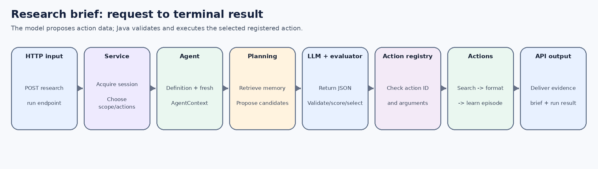
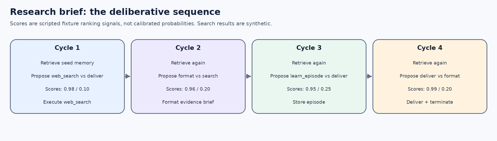

# 1. What this example demonstrates

This use case turns a natural-language request into a short evidence brief. It is intentionally built around the framework's **deliberative procedure** so that the full planning cycle is visible: retrieve relevant memory, propose alternative next actions, evaluate the alternatives, select one action, execute it, incorporate the observation, and repeat.

**Example request**

> Prepare a research brief on retrieval-augmented generation.

**Expected demo outcome:** a brief containing three source-attributed results and a limitation statement. These sources and snippets are synthetic fixtures from `SimulatedWebSearchProvider`; they are not live search results and must not be treated as factual research evidence.

The main code is in:

- `src/main/java/dev/coala/demo/DemoUseCaseService.java`
- `src/main/java/dev/coala/demo/provider/SimulatedWebSearchProvider.java`
- `src/main/java/dev/coala/demo/action/ResearchGroundingActions.java`
- `src/main/java/dev/coala/core/procedure/DeliberativeDecisionProcedure.java`
- `src/main/java/dev/coala/core/action/MemoryRetrievalAction.java`

# 2. CoALA concepts versus framework implementation

| Concept from the paper | How this scenario uses it | Implementation detail (not prescribed by the paper) |
|---|---|---|
| Working memory | Holds the current goal, retrieved memory view, search results, evidence brief, current action and observation. | Keys such as `research.brief` and `web_search.results` are local conventions. |
| Long-term memory | A session-scoped semantic seed is retrieved; a selected learning action later stores an episodic lesson. | `SessionMemoryStore`, `MemoryNamespace`, in-memory cap and seed IDs are framework choices. |
| Retrieval action | Brings relevant semantic/episodic records into the active working-memory context. | `MemoryRetrievalAction` composes `LexicalMemoryRetriever` and `MemoryContextAssembler`. |
| Reasoning action | Uses the configured `LanguageModel` adapter to propose candidates and evaluate them. | `LlmReasoningAction`, operation labels and JSON output contracts are Java implementation choices. |
| Planning | Repeats proposal, evaluation and selection for the next action. | `DeliberativeDecisionProcedure` is a reusable template, not a named paper-mandated Java class. |
| Grounding action | Calls the web-search action and formats the returned source records. | The search provider here is synthetic; it does not access the Internet. |
| Learning action | Stores a qualified procedural lesson as an episodic memory record. | The selected record content and metadata format are application choices. |

The paper's architecture should not be confused with a fixed software class diagram. This example uses the paper's conceptual distinctions and makes additional Java boundaries explicit for reuse and testing.

# 3. Request-to-outcome communication path

{width=6.45in}

1. `CoalaController` receives `POST /api/use-cases/research-deliberative/run`.
2. `DemoUseCaseService` acquires a server-generated session, chooses the research namespace, inserts a semantic seed if it is absent, and assembles the registered action list.
3. `CoalaAgentDefinition` binds the procedure, action registry, context factory and cycle bound. `CoalaAgent` creates a fresh `AgentContext` with a new `WorkingMemory` and the session's long-term-memory object.
4. `DeliberativeDecisionProcedure` reads the current goal and calls `MemoryRetrievalAction` before proposing a next action.
5. The `ReasoningAction` invokes `LanguageModel.generate(...)` using either `ScriptedLanguageModel` or Spring AI's OpenAI adapter. The model output is JSON data, not executable code.
6. `ActionOutputParser` parses candidates and scores; `ActionRegistry` validates IDs and argument contracts; the selection policy chooses one candidate.
7. The selected action runs against the mock provider or the memory store. Its observation is placed in working memory and the next decision cycle begins.
8. On the final cycle, `deliver_research_brief` returns a terminal observation. The API wraps it with the session ID and run metadata.

# 4. Use-case composition

The service registers exactly these actions for this use case:

| Action ID | Component | Role |
|---|---|---|
| `web_search` | Built-in `WebSearchGroundingAction` + `SimulatedWebSearchProvider` | Returns bounded, source-attributed synthetic results and stores them under `web_search.results`. |
| `format_evidence_brief` | Use-case action | Formats result titles, snippets, and URLs into `research.brief`; it does not invent or verify facts. |
| `learn_episode` | Built-in `EpisodicMemoryLearningAction` | Stores a lesson about source attribution and simulated/unverified evidence. |
| `deliver_research_brief` | Use-case action | Returns the prepared brief and terminates the run. |

A pre-seeded semantic record says that research briefs should attribute sources, distinguish evidence from interpretation, and label uncertainty. It is stored in the namespace `(agentId=research-deliberative, sessionId=<server-issued>, tenantId=demo, domain=research)`. This keeps the research memory separate from other use cases in the same session.

# 5. Exact simulated request

```http
POST /api/use-cases/research-deliberative/run
Content-Type: application/json

{"goal":"Prepare a research brief on retrieval-augmented generation"}
```

For a first request, the server creates a session ID. The examples below omit the random ID, timestamps and framework event envelope, but the action sequence reflects the offline scripted fixtures.

# 6. Cycle-by-cycle simulation

{width=6.45in}

## Cycle 1 - retrieve, propose, evaluate, select `web_search`

**Internal retrieval:** `MemoryRetrievalAction.retrieve(goal, context, 3)` queries episodic and semantic memory under the research namespace. `LexicalMemoryRetriever` scores overlap; `MemoryContextAssembler` writes the bounded provenance-preserving records to `retrieved_memories`.

The scripted reasoning adapter returns the following candidate payload:

```json
{
  "candidates": [
    {"actionId":"web_search", "arguments":{
      "query":"Prepare a research brief on retrieval-augmented generation",
      "maxResults":"3"}},
    {"actionId":"deliver_research_brief", "arguments":{}}
  ]
}
```

The evaluator returns `{"rejectAll":false,"scores":[0.98,0.10]}`. The scores are fixture ranking signals, not calibrated probabilities. Candidate 0 is selected. The registry verifies `web_search` and its typed `query` and `maxResults` contract before execution.

`WebSearchGroundingAction` calls the configured `WebSearchProvider` port. In this scenario the implementation is `SimulatedWebSearchProvider`, which returns three `example.org` fixture records. The action stores normalized result maps in working memory and returns the observation “Web search returned 3 source-attributed result(s); details are in working memory.”

**Working memory after execution, conceptually:**

```java
workingMemory.put("latest_action", "web_search");
workingMemory.put("latest_observation", "Web search returned 3 ...");
// The action also stored web_search.results = [result1, result2, result3]
```

## Cycle 2 - format the evidence brief

The procedure retrieves relevant memory again, then proposes `format_evidence_brief(topic=goal)` and a second search. The fixture evaluator returns scores `[0.96, 0.20]`. The formatting action reads `web_search.results`, emits titles/snippets/URLs, labels them as synthetic, writes `research.brief`, `research.topic` and `research.source_count`, then returns a short observation.

This action is a deterministic data-formatting adapter. It is not an additional LLM synthesis step and does not establish that the snippets are true.

## Cycle 3 - learn one episode

The procedure proposes `learn_episode` and `deliver_research_brief`, with scores `[0.95, 0.25]`. It selects `learn_episode`, whose arguments include a bounded lesson:

```json
{
  "actionId":"learn_episode",
  "arguments":{
    "content":"Research lesson: preserve source attribution and label synthetic or unverified evidence.",
    "success":"true",
    "importance":"0.6",
    "source":"research-demo"
  }
}
```

`EpisodicMemoryLearningAction` sanitizes the content, applies the session/domain namespace, and writes a `MemoryRecord` to long-term memory. The run continues; learning is an executed action rather than an out-of-band side effect.

## Cycle 4 - deliver the final brief

The evaluator ranks `deliver_research_brief` above formatting again (`[0.99, 0.20]`). The final grounding action reads `research.brief` and returns it as the terminal observation.

The final text includes:

- the original research topic;
- the fixture source titles, source label, URL and snippets;
- the explicit message `synthetic demo results; not live sources`;
- a limitation statement that the fixture does not substantiate factual claims;
- the next step to replace the provider adapter and verify original sources.

The resulting termination reason is `TERMINAL_ACTION`; four outer decision cycles were executed. Within those cycles the deliberative procedure invokes internal proposal and evaluation operations as required.

# 7. The code that connects the pieces

The service assembles a domain-specific action space but reuses the same procedure and memory infrastructure as the rest of the framework:

```java
return runAgent("research-deliberative", deliberative, List.of(
    new WebSearchGroundingAction(new SimulatedWebSearchProvider(), 5),
    ResearchGroundingActions.formatEvidenceBrief(),
    new EpisodicMemoryLearningAction(),
    ResearchGroundingActions.deliverResearchBrief()),
    goal, maxCycles, session, namespace);
```

The procedure itself keeps the planning loop separate from tool implementations. At each outer cycle it retrieves, proposes, evaluates and selects; the shared loop validates and executes the selected action and returns the observation to working memory.

# 8. What changes with the OpenAI profile?

With `SPRING_PROFILES_ACTIVE=openai`, `LlmReasoningAction` calls `SpringAiLanguageModel` instead of `ScriptedLanguageModel`. Candidate generation and evaluation may vary, and the model may choose a different valid next action. However, **the web-search provider remains synthetic** until `SimulatedWebSearchProvider` is replaced with an actual provider adapter. An OpenAI model does not turn the example `example.org` snippets into live evidence.

Before using real sources, implement the selected search provider, validate published dates and source identities, impose provider-specific quotas, treat fetched text as untrusted input, and retain provenance. If the agent may publish or send research externally, add an explicit approval boundary.

# 9. Debugging checklist

- Confirm `research-deliberative` appears in `GET /api/use-cases`.
- Verify the goal is in working memory before the first proposal.
- Inspect the `RETRIEVAL`, `PROPOSAL`, `EVALUATION`, `SELECTION`, `EXECUTION` and `LEARNING` events in the returned run.
- Ensure the `web_search` result count is 3 and `research.source_count` is set after formatting.
- Confirm the final observation explicitly says the results are synthetic.
- Repeat the same run with the returned `sessionId`: the research namespace can retrieve the prior episodic learning record; other use-case namespaces remain isolated.

# 10. Fidelity and limitations

The paper supplies the conceptual memory/action/decision-making architecture and the planning distinction. The named Java classes, JSON schema, scores, search result fixture, endpoint and namespace scheme are implementation decisions. The scenario is an execution simulation, not a claim that CoALA requires this exact class composition or that a live web search was performed.
