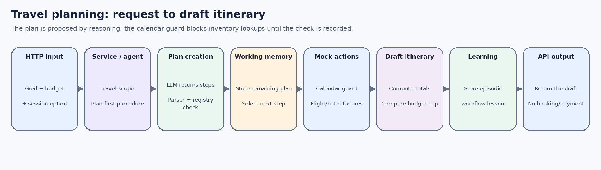
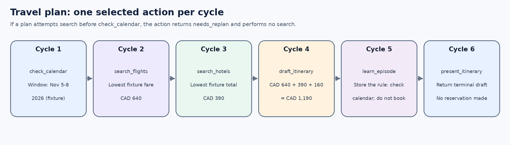

# 1. What this example demonstrates

This use case produces a **draft itinerary** by preparing a plan first and executing one registered step per decision cycle. It illustrates how a use case combines a reusable decision procedure with domain-specific action adapters without putting the travel workflow inside the framework's generic loop.

**Example request**

> Plan a 4-day trip to Paris next month within CAD 1400, check my calendar, and suggest flights and hotels. Do not book anything.

**Expected demo outcome:** a draft based on mock calendar, flight and hotel data. The sample fixture uses November 5-8, 2026, a flight fare of CAD 640, a hotel total of CAD 390 and a local budget estimate of CAD 160. The sample subtotal is CAD 1,190 against the requested CAD 1,400 cap. No external provider is contacted and no reservation is made.

Main code:

- `src/main/java/dev/coala/demo/DemoUseCaseService.java`
- `src/main/java/dev/coala/core/procedure/PlanFirstDecisionProcedure.java`
- `src/main/java/dev/coala/demo/action/TravelGroundingActions.java`
- `src/main/java/dev/coala/core/agent/CoalaAgent.java`
- `src/main/java/dev/coala/llm/ScriptedLanguageModel.java`

# 2. Paper concept and implementation boundary

| CoALA concept | Role in this scenario | Java implementation choice |
|---|---|---|
| Working memory | Stores current goal, pending plan, calendar observation, flight/hotel options and the draft itinerary. | Keys prefixed with `travel.` are local conventions. |
| Reasoning action | Generates a multi-step plan from goal, observations and registered action descriptions. | `LlmReasoningAction` with operation label `PLAN_FIRST`. |
| Planning | Proposes a plan and selects the next plan step for execution. | `PlanFirstDecisionProcedure` stores remaining steps in `plan.first_steps`. |
| Grounding actions | Read calendar fixture, return travel inventory fixtures, compose and present a draft. | `TravelGroundingActions` are mock adapters, not CoALA primitives. |
| Learning action | Records a travel-planning lesson in episodic memory. | `EpisodicMemoryLearningAction` is explicitly selected as a plan step. |
| Decision loop | Executes one selected step, incorporates the returned observation, then runs the next cycle. | `AbstractLoopingDecisionProcedure` is a shared code-reuse base. |

CoALA does not prescribe a `PlanFirstDecisionProcedure` class or a travel-specific step order. The planner proposes the plan. This demo also uses action-level preconditions to ensure that a flight/hotel fixture cannot be queried before the calendar observation has been recorded. The guard returns `needs_replan` without making a provider call; it does not silently repair or reorder the plan.

# 3. End-to-end communication path

{width=6.45in}

1. The controller receives the user goal and `DemoUseCaseService` acquires a session.
2. The service constructs a travel-scoped namespace and binds `PlanFirstDecisionProcedure`, the travel action list, `AgentContextFactory`, and the cycle limit into a `CoalaAgentDefinition`.
3. A fresh `AgentContext` is created. Its `WorkingMemory` starts with the goal and initial observation; long-term memory is the scoped session store.
4. On cycle 1, the plan-first procedure sees no pending plan, so it calls `ReasoningAction.reason("PLAN_FIRST", ...)`.
5. The LLM returns structured JSON containing registered action IDs and string-valued arguments. `ActionOutputParser` parses the plan; `ActionRegistry` validates every step before it is stored.
6. The first action is selected; the shared loop records its structured identity/arguments in working memory, executes it, and stores the returned observation.
7. On later cycles the procedure removes the next step from `plan.first_steps`. It does not make another reasoning call unless no plan remains or the latest observation matches the configured replan condition (`failure:`, `error:`, or `needs_replan`).
8. The terminal `present_itinerary` action returns the draft. The API returns it as `finalObservation` with `TERMINAL_ACTION`.

# 4. Exact request and simulated plan

```http
POST /api/use-cases/travel-plan-first/run
Content-Type: application/json

{"goal":"Plan a 4-day trip to Paris next month within CAD 1400, check my calendar, and suggest flights and hotels. Do not book anything."}
```

The deterministic offline adapter produces a plan with six steps. In the scripted version the values below are fixture-driven; when using OpenAI, the proposed plan may differ and is still checked against the registered action contracts.

```json
{
  "steps": [
    {"actionId":"check_calendar", "arguments":{}},
    {"actionId":"search_flights", "arguments":{"destination":"Paris","origin":"YUL"}},
    {"actionId":"search_hotels", "arguments":{"destination":"Paris","checkIn":"2026-11-05","nights":"3"}},
    {"actionId":"draft_itinerary", "arguments":{"budgetCad":"1400"}},
    {"actionId":"learn_episode", "arguments":{"content":"Travel workflow lesson: check the calendar before inventory searches and never book from mock results.","success":"true","importance":"0.6","source":"travel-demo"}},
    {"actionId":"present_itinerary", "arguments":{}}
  ]
}
```

The plan is a proposal. Each step is validated against the current action registry before execution. There is deliberately no `book_flight`, `reserve_hotel` or `charge_payment` action in this action space.

# 5. Cycle-by-cycle simulation

{width=6.45in}

| Cycle | Selected action | What it reads/writes | Observation / next decision |
|---|---|---|---|
| 1 | `check_calendar` | Writes `travel.calendar` and `travel.calendar.checked=true`. | The mock window 2026-11-05 through 2026-11-08 has no seeded conflict. |
| 2 | `search_flights` | Requires `travel.calendar.checked`; writes two `travel.flight_options`. | Fixture fares: CAD 640 and CAD 710 round-trip from YUL to Paris. |
| 3 | `search_hotels` | Requires the calendar check; writes two `travel.hotel_options`. | Fixture totals: CAD 390 and CAD 460 for three nights. |
| 4 | `draft_itinerary` | Requires calendar, flight and hotel observations; reads `budgetCad`; writes `travel.proposed_itinerary`, `travel.estimate_cad`, `travel.budget_cad`, `travel.within_budget`. | Computes CAD 640 + CAD 390 + CAD 160 = CAD 1,190, checks against CAD 1,400, and stores a draft. |
| 5 | `learn_episode` | Writes a bounded episodic memory item in the travel namespace. | Records that calendar inventory should be checked first and mock availability must never be used to book. |
| 6 | `present_itinerary` | Reads `travel.proposed_itinerary`. | Returns the draft and terminates. No booking or payment occurs. |

## The precondition is a guard, not the planner

`search_flights` and `search_hotels` check `travel.calendar.checked`. If a plan chooses either action before the calendar step, it returns an observation beginning `needs_replan:` and does not query the provider port. `PlanFirstDecisionProcedure` recognizes this marker and asks for a replacement plan on the next cycle. The decision procedure is not hard-coded to reorder the travel actions; the action adapter only enforces a safety precondition.

```java
if (!Boolean.parseBoolean(
        context.workingMemory().getString("travel.calendar.checked", "false"))) {
    return ActionResult.continueWith(
        "needs_replan: calendar availability must be checked before flight search; " +
        "no provider query was made.");
}
```

This guarantee is only as complete as the action set. Before adding a real booking integration, its own authorization and approval policy must be enforced at the execution boundary too. In this project no booking action is registered.

# 6. How components communicate

## Plan creation

The plan-first procedure builds an instruction from the goal, selected working-memory view, and `ActionCatalogFormatter`. The model is asked for JSON data. The action parser converts each plan step into an `ActionCall`; the registry verifies that each ID exists, all required arguments are present, no unsupported arguments are supplied, and values satisfy their declared contracts.

## Step execution

The shared loop writes the chosen action ID and arguments into `selected_action`, `selected_action_id`, and `selected_action_arguments` before invoking the registered action. Each action returns an `ActionResult`; the loop stores its observation as `latest_observation`. Those observation changes are the feedback channel for the next decision cycle.

## Working-memory values

Representative keys created by the travel actions are:

```java
travel.calendar          // date window, conflict summary, simulated status
travel.calendar.checked  // true only after the calendar fixture was read
travel.flight_options    // two mock round-trip fares
travel.hotel_options     // two mock lodging totals
travel.proposed_itinerary // final draft text
travel.estimate_cad      // computed fixture subtotal
travel.within_budget     // boolean comparison against budgetCad
```

The framework's prompt-context policy explicitly allow-lists the travel keys needed by follow-on reasoning. It does not dump every value stored in working memory into every prompt.

# 7. Expected final outcome

The terminal response is approximately:

```text
Proposed trip to Paris
Date window: 2026-11-05 to 2026-11-08 (mock calendar fixture)
Flight: lowest fixture fare CAD 640
Hotel: lowest fixture total CAD 390
Local transport/food estimate: CAD 160
Illustrative subtotal: CAD 1190
Budget cap: CAD 1400
Budget check: WITHIN budget (computed from fixture totals)
Calendar conflicts: none in the fixture; real availability is unverified.
Safety boundary: this is a draft only. No booking, payment or external account change occurred.
```

The API response includes the session ID, procedure ID `plan-first-revisable`, six cycles, `TERMINAL_ACTION`, final text and decision events. The exact JSON envelope can evolve with the API; the final observation is the useful outcome.

# 8. What is mocked and what is reusable

Reusable framework components: `PlanFirstDecisionProcedure`, `CoalaAgent`, `CoalaAgentDefinition`, `AgentContextFactory`, `WorkingMemory`, `ActionRegistry`, typed action contracts, `EpisodicMemoryLearningAction`, `LlmReasoningAction`, and the configured `LanguageModel` adapter.

Use-case-specific mock actions: `check_calendar`, `search_flights`, `search_hotels`, `draft_itinerary`, and `present_itinerary`. These only read/write in-memory demo state. The OpenAI profile changes the LLM response source only; it does not provide calendar access, real flight/hotel results, booking or payment capability.

# 9. How to replace mocks safely

1. Implement actual calendar, flight and hotel adapters behind the same action contracts.
2. Authenticate the current principal and prove that the principal may access the specific calendar/travel profile; the demo session ID alone is not identity.
3. Keep the calendar precondition as a domain safety guard, but verify it against a trustworthy, timestamped calendar result.
4. Add explicit approval and action-level authorization before booking or payment. Do not merely add `book` to the model's action catalogue.
5. Add provider timeouts, idempotency where supported, audit records, cancellation/compensation behavior, and tests for stale prices and availability races.
6. Use real integration tests against sandbox providers; keep unit tests on deterministic fixtures.

# 10. Fidelity and limitations

The paper defines the conceptual decision cycle and planning role; it does not mandate a plan-first procedure, these Java keys, the HTTP endpoint, the travel itinerary format, or the six-step sequence. The plan-first implementation is one useful framework extension. The fixtures are deliberately non-binding so the example demonstrates composition and execution flow without pretending to book travel.
