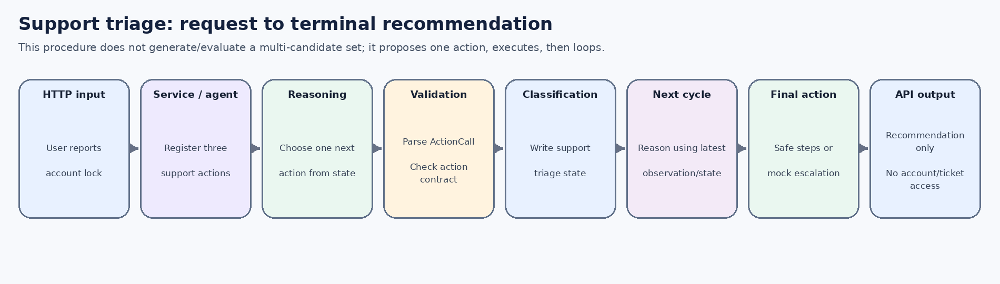
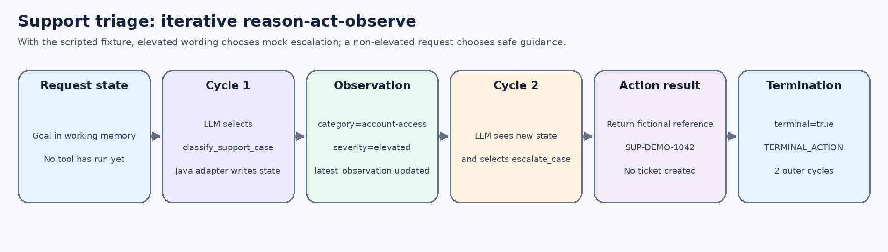

# 1. What this example demonstrates

This example receives a support request, classifies it, incorporates the classification observation into working memory, then reasons again to choose a safe next action. It demonstrates **iterative reason-act-observe** rather than a precomputed plan or a multi-candidate evaluator.

**Example request**

> I cannot sign in after several attempts; my account is locked.

**Expected demo outcome:** classification as an elevated account-access case followed by a recommendation to escalate through the provider's verified support channel. The reference `SUP-DEMO-1042` is fictional. No account is accessed, unlocked, authenticated or modified, and no ticket is created.

Main code:

- `src/main/java/dev/coala/demo/DemoUseCaseService.java`
- `src/main/java/dev/coala/demo/action/SupportTriageActions.java`
- `src/main/java/dev/coala/core/procedure/IterativeReasonActDecisionProcedure.java`
- `src/main/java/dev/coala/core/procedure/AbstractLoopingDecisionProcedure.java`
- `src/main/java/dev/coala/core/WorkingMemoryPromptContextBuilder.java`

# 2. Concept mapping

| CoALA concept | Role here | Implementation choice |
|---|---|---|
| Working memory | Carries the goal, latest observation and structured `support.triage` output between cycles. | The key prefix and classification schema are use-case conventions. |
| Reasoning action | Selects one next registered action based on goal, action catalogue and current observation. | `LlmReasoningAction` uses `ITERATIVE_NEXT_ACTION`. |
| Planning | Proposes and selects a single next action in each cycle; no separate candidate-evaluation stage is used. | `IterativeReasonActDecisionProcedure` is a Java template. |
| Grounding action | Classification fixture and final safe guidance/escalation recommendation. | `SupportTriageActions` are deterministic mock adapters. |
| Decision cycle | Executes one action and writes its observation before the next reasoning call. | `AbstractLoopingDecisionProcedure` implements reusable loop mechanics. |

This scenario deliberately does **not** call long-term retrieval during its procedure. The framework does not force every agent to use every memory type or every action. Here the immediate classified state in working memory is sufficient for the next action in the scripted trace. Research demonstrates explicit retrieval; this case demonstrates iterative feedback.

# 3. End-to-end communication

{width=6.45in}

1. `CoalaController` receives the request and routes it by use-case ID.
2. `DemoUseCaseService` acquires a session and constructs the support action registry.
3. `CoalaAgent` creates a fresh context and calls `IterativeReasonActDecisionProcedure.run(...)`.
4. On each cycle, `LlmReasoningAction` renders the allow-listed working-memory view and action catalogue, then calls the configured `LanguageModel`.
5. The model returns one `ActionCall` as JSON. The parser parses it and the shared loop validates it against the authoritative action registry.
6. The selected action writes structured state or returns a terminal recommendation. `AbstractLoopingDecisionProcedure` stores `latest_action` and `latest_observation`.
7. If nonterminal, the next cycle uses the new observation and working memory. If terminal, the procedure returns `AgentRunResult`; the API sends the result and session ID to the caller.

# 4. Exact request

```http
POST /api/use-cases/support-iterative/run
Content-Type: application/json

{"goal":"I cannot sign in after several attempts; my account is locked."}
```

# 5. Cycle-by-cycle simulation

{width=6.45in}

## Cycle 1 - classify the request

The scripted model sees the registered action catalogue and emits:

```json
{"actionId":"classify_support_case","arguments":{}}
```

`ActionRegistry` validates that the selected action exists and has no required arguments. The action reads the goal from working memory, applies the deterministic demo rule, and writes this structured state:

```java
context.workingMemory().put("support.triage", Map.of(
    "category", "account-access",
    "severity", "elevated",
    "source", "deterministic-demo-rule"));
```

The action returns an observation similar to:

```text
Mock triage recorded category=account-access, severity=elevated.
No user account was accessed.
```

The shared loop records `latest_action=classify_support_case` and `latest_observation` before advancing to cycle 2. The model has not performed the classification action itself; it proposed a registered action, and the Java adapter performed the mock operation.

## Cycle 2 - select a next action from the new state

The iterative procedure calls the model again. The prompt includes the original goal, the latest observation and the allow-listed `support.triage` working-memory key. In scripted mode, the fixture recognizes the locked-account wording and returns:

```json
{"actionId":"escalate_case","arguments":{}}
```

The action catalogue describes this action as a simulated recommendation and marks it high risk; the action does not connect to a ticketing system. The Java action executes and returns a terminal observation:

```text
Escalation recommendation: use the provider's verified support channel
for account-access review. Demo reference SUP-DEMO-1042 is fictional;
no real support ticket, identity check or account action occurred.
```

The shared loop sees `ActionResult.terminal=true`, appends a termination event, and returns the run with `TERMINAL_ACTION` after two cycles.

# 6. Why this is not a deliberative planner

The iterative procedure proposes one action per cycle. It does not ask the model for a multi-candidate set, produce scores for each candidate, or select an argmax across the alternatives. It relies on feedback from the last executed action to guide the next proposal.

A deliberative procedure would instead call a candidate proposer, evaluate multiple candidates, select one (or reject all), then execute the selected action. Research uses that other procedure in this project. The distinction is visible in the number and kind of reasoning operations each cycle performs.

# 7. Component communication, step by step

| Component | Input | Output/side effect | Next consumer |
|---|---|---|---|
| `CoalaController` | HTTP request JSON | Goal and optional session metadata passed to service | `DemoUseCaseService` |
| `DemoUseCaseService` | ID, goal, session | Selects `iterative` procedure and three support actions | `CoalaAgentDefinition` |
| `CoalaAgent` | Definition and `AgentRunRequest` | Creates isolated `AgentContext` and starts run | `IterativeReasonActDecisionProcedure` |
| `LlmReasoningAction` | Operation, instruction, working-memory view | JSON string from `LanguageModel` | `ActionOutputParser` |
| `ActionOutputParser` | JSON string | `ActionCall(actionId, arguments)` | `ActionRegistry` / shared loop |
| `ActionRegistry` | `ActionCall` | Registered action after contract validation | The selected mock action |
| `classify_support_case` | Goal in working memory | Writes `support.triage`, returns observation | Next decision cycle |
| `escalate_case` or `suggest_safe_steps` | Current case state and goal | Final safe recommendation, without side effects | `AgentRunResult` |
| `CoalaController` response | `UseCaseRunResponse` | Session ID and final run payload | Caller/UI |

# 8. Safety properties and remaining production work

The demo uses no credentials and does not access accounts. The action registry prevents arbitrary model-generated code execution. The only action effects are deterministic in-memory state writes and final text. The fictional escalation ID must never be integrated as if it represented a real ticket.

Before production use:

- Bind the session to an authenticated principal; a session ID is not identity.
- Define a domain-specific policy for risk/severity and ensure it cannot be overridden solely by an LLM score or string.
- Implement a real support integration behind a narrow provider port, with server-side authorization, audit, timeouts and least privilege.
- Require explicit human approval for any action that changes account state, resets credentials, contacts another party or exposes customer data.
- Treat user-provided messages and retrieved ticket content as untrusted input; do not let them rewrite action policies.
- Add end-to-end tests for locked, non-locked, ambiguous, suspected compromise, model failure, action failure and maximum-cycle termination paths.

# 9. Run and debug

```bash
curl -X POST http://127.0.0.1:8080/api/use-cases/support-iterative/run \
  -H 'Content-Type: application/json' \
  -d '{"goal":"I cannot sign in after several attempts; my account is locked."}'
```

In the response, verify:

- procedure ID `iterative-reason-act`;
- two cycles in scripted mode;
- first selected action `classify_support_case` and second selected action `escalate_case` in the cycle events (event messages are normalized for tracing; inspect controlled debug logs if more detail is needed);
- final termination reason `TERMINAL_ACTION`;
- final observation identifies the reference as fictional and says no real ticket/account action occurred.

For a non-elevated request such as “How can I find my account settings?”, the scripted fixture chooses `suggest_safe_steps` on cycle 2 instead. This is also deterministic demonstration behavior, not evidence that the scripted adapter can understand arbitrary customer-support requests.

# 10. Fidelity and limitations

The recurring decision cycle, internal reasoning operation, action execution and returned observations reflect the concepts used to map the paper to this project. The class names, triage labels, keyword heuristic, HTTP API, scripted fixture and two-cycle trace are engineering choices. This scenario is not a production support agent and is not intended to diagnose account security from text alone.
